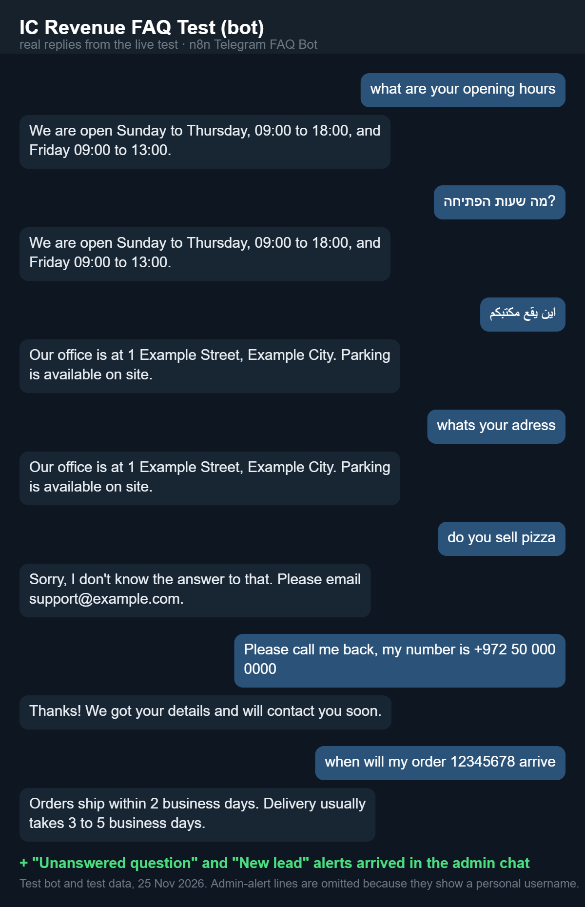

# Telegram FAQ Bot for n8n

**Your Telegram bot answers customer questions instantly, only from your own Q&A list.** No made-up answers, no AI key needed.

**👉 Get the ready-made template ($29): https://contra.com/products/h3HQhFgq-telegram-faq-bot-for-n8n-answers-only-from-your-qanda**

 

## What it does
- **Matches by keywords**, so different wording still works: typos, plurals, case and punctuation are handled in **English, Hebrew and Arabic** (letter forms and niqqud normalized).
- **Lead capture:** a message with an email or phone number is forwarded to *your* Telegram chat with the customer's name; the customer gets a thank-you. Order numbers and dates are not mistaken for phones.
- **Unknown questions** get your fallback message, and you get an alert so you know what to add.
- **Duplicate-safe** (a re-sent message is answered once) and **failure-safe** (3 retries; an undeliverable reply is set aside without stopping the others).
- **Q&A in the workflow or in a Google Sheet** (publish as CSV, paste the link).
- **Built-in test path:** check the matching before you connect a bot.

## Tested
| Test | Result |
|---|---|
| Live on real Telegram (test bot, 8 real messages: EN / HE / AR / typo / unknown / lead / order number / `/start`) | 10 of 10 replies and alerts delivered |
| Duplicate delivery | answered once |
| Reply to a chat that doesn't exist | isolated, others unaffected |
| Offline checks inside n8n 2.49.6 (Q&A inline and from CSV) | 15 of 15 |

Not run live: n8n's own webhook activation (it needs your n8n on public HTTPS; standard n8n behaviour).

## Get it
- **Ready-made template, $29** (workflow + setup guide + sample CSV + test checklist): https://contra.com/products/h3HQhFgq-telegram-faq-bot-for-n8n-answers-only-from-your-qanda
- **Want it set up or customized for you** (buttons, CRM hand-off, more languages, an AI fallback limited to your own content)? https://contra.com/s/OYEArB26-n8n-workflow-built-or-fixed-tested-before-hand-off

## Honest limits
Keyword matching, not meaning: add the phrasings your customers really use. Text messages only.

---
Built by Itay Cohen, n8n & API automation, tested before hand-off.
